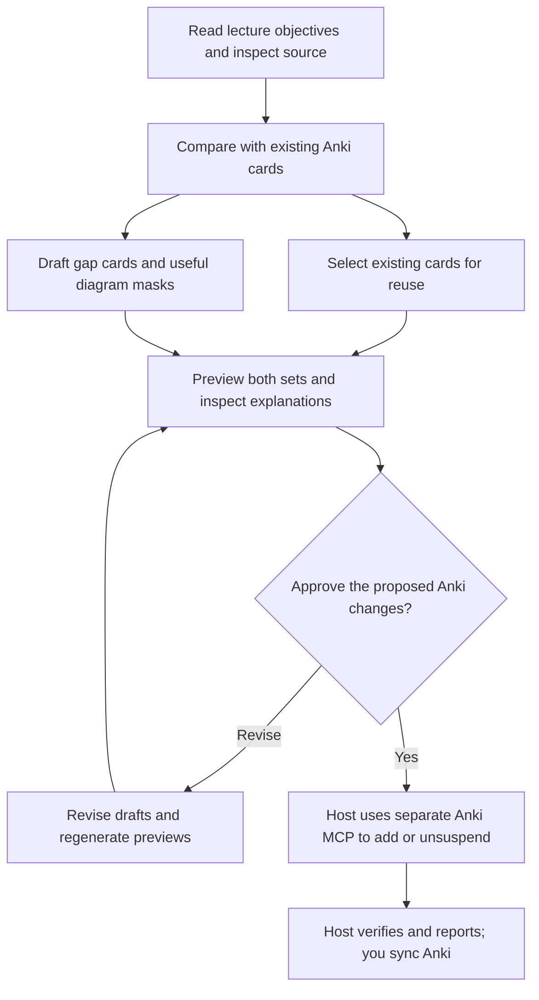

# AnkiPlus MCP

**Turn lecture material into flashcards you can inspect, improve and send to Anki—with help from your AI assistant.**

AnkiPlus gives an AI assistant tools to read lecture PDFs, find diagrams, recognise
image labels, build image occlusions, check card formatting and show previews.
You describe the study task in ordinary language; your assistant chooses which
tools to use and drafts the questions. You can also work on existing cards or
pasted notes without starting from a PDF.

MCP (Model Context Protocol) is how an AI app connects to tools. AnkiPlus is an
MCP server running locally on your computer. It has no chat interface of its own.
Use it through a compatible host such as Claude Code, Claude Desktop or Codex.

[Quick start](#quick-start) · [Worked lecture workflow](docs/study-workflow.md) · [All 33 tools](docs/tools.md) · [Setup guide](docs/setup.md) · [Developer guide](docs/developer-guide.md)

## What can it help you do?

| Your study task | What AnkiPlus provides |
| --- | --- |
| Make cards from a lecture | Extracted text, slide references, figures and learning objectives for your assistant to draft from. |
| Reuse cards you already own | Source material and local previews to help your assistant compare existing Anki cards with the lecture, then draft only the gaps. Collection search and unsuspension use the separate Anki MCP. |
| Learn a labelled diagram | OCR label regions and image-occlusion masks that hide labels for recall practice. |
| Check how cards will look | Front/back images and contact sheets: several card previews on one image. |
| Improve an existing deck | Local snapshots, formatting checks, optional review proposals and a preview of suggested field changes. |
| Keep track of coverage | Optional checks against extracted slides/objectives, with recorded reasons for deliberate omissions. |
| Get cards into Anki | Validated create/update payloads, media references and text import files. Your assistant handles the Anki connection separately. |

A **cloze** card hides part of a sentence, such as “The {{c1::mitochondrion}}
produces ATP.” An **image occlusion** hides a region of a diagram. A **workspace**
is a local folder holding one task's source snapshot, cards, previews and results,
so your assistant can return to it later.

## How it fits together

| Part | Responsibility |
| --- | --- |
| **You** | Choose the learning goal and inspect the cards before studying. |
| **Your AI assistant** | Understand the material, draft questions, choose tools and evaluate proposed changes. |
| **AnkiPlus MCP** | Do mechanical work: extraction, OCR, masks, validation, previews and payload preparation. |
| **A separate Anki MCP** | Read your Anki collection and execute additions, updates, media storage or suspension requested through your host. |

AnkiPlus never connects to Anki or changes its collection. Configure the companion
Anki MCP separately if you want collection access. Source extraction, local card
checks and payload preparation can run without an Anki connection. You can also
use the generated text import files through Anki's import interface.

There is no compulsory pipeline or reviewer panel. Ask for one diagram, a few
slides, a preview of existing cards, or a full lecture task. AI drafting and
reviews can contain mistakes; formatting and coverage checks do not establish
that a fact is correct.

## Quick start

### 1. Install the prerequisites

You need **Node.js 18+**, **uv**, and an AI host that supports local stdio MCP
servers. uv manages Python and the server dependencies. macOS and Linux are
supported; Windows is untested.

- [Install Node.js](https://nodejs.org/)
- [Install uv](https://docs.astral.sh/uv/getting-started/installation/)

Tesseract is needed for OCR, and a browser is needed for previews. You can add
those when you need them; other tools work without them.

### 2. Register AnkiPlus in your host

Replace `/absolute/lectures` with the folder containing your study material:

```sh
npx -y github:Hamza-Xoho/ankiplusMCP#v0.3.0 init --host claude-code --source-root /absolute/lectures
```

Change `--host` to `claude-desktop`, `codex`, `opencode` or `hermes` as appropriate.
`init` shows the proposed changes, backs up configuration files it edits, and
installs the optional companion skill where supported. Hermes prints a manual
configuration step. The first start downloads dependencies and may take a minute
or more. Restart or reconnect your host after registration.

For another host, use `init --print` to get a configuration snippet.
See [host-specific setup and options](docs/setup.md#install-and-register).

### 3. Check optional features

```sh
npx -y github:Hamza-Xoho/ankiplusMCP#v0.3.0 doctor
npx -y github:Hamza-Xoho/ankiplusMCP#v0.3.0 setup
```

`doctor` reports missing prerequisites. `setup` offers to download Chromium for
previews; an installed Google Chrome can also be used. For OCR, install
Tesseract (`brew install tesseract` on macOS, or
`sudo apt-get install -y tesseract-ocr` on Ubuntu/Debian).

### 4. Give your assistant a study task

> Use AnkiPlus to read `/absolute/lectures/cell-biology.pdf`. Start with slides
> 2–8, draft a small set of cloze cards using only those slides, include slide
> references, and show me front/back previews before preparing anything for Anki.

Your assistant calls the tools; you do not need to type MCP requests yourself.
Only files under configured source roots can be read. Requested sources are
copied into local workspaces; originals are never changed. The assistant still
receives the tool results, so its provider's data handling applies to material
you share with it.

## Study with it

### Reuse existing cards and fill the gaps

> Read the learning objectives in this lecture. Search my existing deck through
> Anki MCP and suggest cards that already cover them. Draft new cards only for
> the gaps. Give new cards useful explanations and relevant lecture images on
> their backs. Use image occlusion where identifying labels is a learning goal.
> Show every proposed existing and new card, including both sides, and wait for
> my approval before changing Anki.

Matching is a judgement your assistant makes, not an automatic deduplication
feature of AnkiPlus. Ask it to show which objective each proposed card covers,
identify conflicts with your lecture, and explain any omissions.

A typical task looks like this; it is an example, not a required pipeline:



Existing cards can stay in their original decks. New notes can generate several
study cards, especially with multiple cloze deletions or diagram masks, so ask
for separate counts of new notes, new cards and existing cards to unsuspend.
The [worked study guide](docs/study-workflow.md) explains the steps, review
choices and recovery from problems seen in an example run.

### Learn a diagram

> Find the labelled diagram on slide 12. Show me the figure, recognise its labels,
> and propose masks for the main structures. Let me inspect the mask preview
> before saving image-occlusion cards.

The assistant can export a figure, run OCR, adjust rectangles and build masks.
OCR can miss or misread labels; masks can also be supplied manually. Building
an occlusion returns fields and media, which must then be saved as a card.

### Improve existing cards

> Fetch these notes through Anki MCP, copy them into an AnkiPlus workspace, and
> show me how they look. Suggest clearer wording, show the before/after changes,
> and wait for me before applying them to Anki.

AnkiPlus supports arbitrary field names in supplied notes. For closer previews,
your assistant can supply the note type's templates/CSS or actual front/back
HTML. Local rendering approximates Anki; it does not run its full template
engine or add-on JavaScript.

### Check what you missed

> Compare the draft cards with the lecture's learning objectives. Identify gaps
> and record any slides we deliberately left out, with a reason for each.

Coverage and house-style checks are optional. Coverage needs completed source
extraction and useful slide references on your cards. It cannot judge whether
a question teaches the concept well.

### Resume a task

> List my AnkiPlus workspaces and reopen the one for cell biology. Show the saved
> cards and the latest report before making further changes.

Workspaces persist between sessions. There is no shared “current workspace”:
your assistant uses an explicit ID, and revision checks protect edits from
overwriting newer work. `save_cards` replaces the entire local card set rather
than appending to it.

## Explore the tools

| Tool group | Tools |
| --- | --- |
| Setup and workspaces | `capabilities`, `get_guidance`, `create_workspace`, `list_workspaces`, `get_workspace` |
| Lecture text and figures | `extract_source`, `read_source`, `search_source`, `get_page_image`, `list_figures`, `get_figure`, `export_figures` |
| Images and occlusions | `import_image`, `ocr_image`, `build_occlusion` |
| Cards and targets | `resolve_target`, `save_cards`, `get_cards`, `save_omissions`, `check_cards`, `render_cards` |
| Optional review | `prepare_review`, `submit_review`, `apply_changes` |
| Anki handoff and reporting | `prepare_write`, `record_external_results`, `get_report` |
| Artifacts, jobs and diagnostics | `list_artifacts`, `read_artifact`, `get_image`, `get_job`, `cancel_job`, `measure_usage` |

The [complete tool reference](docs/tools.md) explains each tool's inputs, results,
prerequisites, examples and implementation. Long extraction, figure export, OCR
and rendering operations return jobs; the assistant checks `get_job` for results.

## Configuration and help

- [Documentation index](docs/README.md): current public guides, legacy usage and development records, grouped by audience.
- [Worked study workflow](docs/study-workflow.md): reuse existing cards, draft gaps, improve backs, review and approve the handoff to Anki.
- [Setup and troubleshooting](docs/setup.md): host registration, browser choice, source folders, workspace location and unattended commands.
- [Profiles](docs/setup.md#profiles): standard Anki `Cloze` defaults or the optional `ColdRecall Cloze` conventions.
- [Developer guide](docs/developer-guide.md): architecture, tool internals, development, testing and the optional stdio container.
- [Companion skill](skills/ankiplusmcp/SKILL.md): optional instructions your host can use for study tasks.

AnkiPlus speaks MCP over stdio, opens no port and requires no model API key of
its own. Current limits include 500 PDF pages, 500 saved cards per workspace,
64 MiB input files and 20 million decoded image pixels. See
[limits and errors](docs/tools.md#limits-and-errors) for details.

## For developers

```sh
git clone https://github.com/Hamza-Xoho/ankiplusMCP.git
cd ankiplusMCP
python3 -m venv .venv
.venv/bin/pip install -e '.[dev]'
.venv/bin/python -m playwright install chromium
./scripts/check.sh
```

Use Python 3.12+ and Node 18+, and install system Tesseract for OCR tests. Linux
may also need Playwright's system dependencies. See the [developer setup and
checks](docs/developer-guide.md#development-setup) for the full commands and test
scope. The server is in `src/ankiplusmcp/`; the dependency-free Node launcher is
in `launcher/`. The [developer guide](docs/developer-guide.md) explains how the
MCP layer reuses the deterministic `src/cards/` toolkit without imposing its
legacy workflow.

## Project history and licence

AnkiPlus grew out of [Lecture2Cards](https://github.com/Hamza-Xoho/Lecture2Cards).
The original `cards` CLI and `/ankiv2` workflow remain available, with their
original gate rules. See the [legacy guide](docs/legacy/README.md),
[legacy architecture](docs/legacy/architecture.md) and
[capability mapping](docs/capabilities.md). Those mandatory pipeline rules do not
apply to the independent AnkiPlus tools.

Project code is [MIT-licensed](LICENSE), with upstream attribution retained.
PyMuPDF, a dependency, has separate AGPL/commercial licensing; see the
[dependency licence notes](docs/setup.md#licences).
