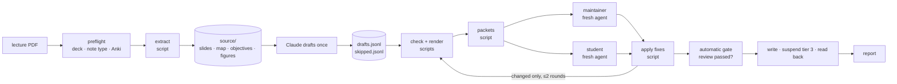

# /anki v2 — Product Brief

> **One-line pitch:** A rebuilt `/anki` skill that turns one lecture PDF into AnKing-quality, reviewed, tagged Anki cards at about a third of today's usage. It moves every mechanical step into scripts and keeps Claude for judgement only.

**How to read this.** This brief is the *why and what*. It is the reference for what to build and the goals every build decision answers to. Script-level requirements live in the companion TRD (`anki-v2-trd.md`). The SKILL.md text itself is written later by a dedicated skill-writing method, from the spec in §4b.

Item status follows these rules:
- `agreed` means the owner decided it.
- `proposed` means it was inferred and the owner should check it.
- IDs are stable and are never renumbered.

---

## 1. TL;DR
status: `draft`

`/anki` makes Anki cards from lecture PDFs in the AnKing house style, with an independent review before anything reaches Anki. It works, but one build of a 24-slide lecture (MED241 L006, 40 notes) hit the plan usage limit before the cards were written. That run made 76 model calls, re-read about 12M tokens and was compacted twice. Most of that usage came from Claude doing mechanical work and from avoidable failures, not from judgement.

v2 keeps the same cards and the same quality bar, but changes who does what:
- **Scripts** extract the lecture into text plus a slide map, check and lint the drafts, render them, assemble reviewer packets, apply fixes and prepare the Anki writes.
- **Claude** reads the slide text once, drafts once into a file, and sends two fresh, pinned reviewer agents the packet paths. Once the review passes, the cards are written without asking (ADR-9).

The skill file shrinks to a short core plus phase files that load only when needed.

Done means a re-run of L006 passes every waste check in §6 (none of the L006 waste patterns recur), with no drop in card quality. There is no fixed cost target (ADR-10).

---

## 2. Problem & Motivation
status: `draft`

**Problem.** One BUILD of MED241 L006 (24 slides, 40 notes, Sonnet 4.6, 2–3 Nov 2026) used up a whole Pro usage window before the cards were written. Measured from the session transcript:

| Measure | Value |
|---|---|
| Model calls | 76 main-agent calls + 15 reviewer calls + 2 auto-compactions |
| Tokens processed | ≈12M (≈$9 at Sonnet API prices, used only as a yardstick) |
| Context at the first call | 79k tokens, before any lecture content |
| Context before the first card was drafted | 130k |
| Peak context | 166k |

**Where the usage went (measured share of cost):**

| Share | Cause |
|---|---|
| 43% | **Writing to Anki.** The deck `All::MED241::6. …` has three levels and AnkiMCP only creates two. Claude sent the full 40-note payload three times, tried curl, ports, AppleScript and Python (all blocked), then resumed twice after the prompt cache had expired. About ⅓ of the total was pure waste. |
| 24% | **Self-checking.** The main agent opened contact sheets itself and applied review fixes with 9 separate edits, each re-reading ~150k of context. |
| 13% | **Review panel.** Both reviewers were launched as *forks*, so each inherited ~141k of context. The student opened its 10 sheets one per turn. The maintainer checked cards against the author's own summary of the slides, never the source, so the fidelity check was circular. |
| 12% | **Setup.** The 52 KB SKILL.md (~13k tokens) was loaded in full, and the PDF was read as 24 page images (~33k tokens) that then rode along in context. |
| 6% | **Drafting.** A manifest and then the drafts restated the same facts twice. |

**Gap.** The current skill already contains token-budget rules, but they are prose buried in 52 KB, and nothing enforces them. The model still does work a script should do: reading page images, editing JSON note by note, assembling reviewer briefs and retrying failed writes. The deck-depth conflict ("two levels" versus "your existing convention wins") has no rule. The approval gate lives in CLAUDE.md, not the skill.

**Cost of doing nothing.** About one lecture per usage window, which can't keep pace with the M1 lecture load. The "independent review" claim also stays false.

---

## 3. Users & Use Cases
status: `draft`

**Primary user:** the owner, an medical student. He is the single operator, on macOS, running Claude Code in `this repository` on a paid plan.

**Other actors:**
- the orchestrating Claude session
- two reviewer subagents (maintainer and student)
- the `learning` skill, which calls HARVEST

| Use case | Actor | Goal | Trigger |
|---|---|---|---|
| UC-1 BUILD | the owner | `/anki` + lecture PDF produces reviewed cards in the right deck, tagged and tiered | Before or after a lecture |
| UC-2 Partial BUILD | the owner | Cards from a slide range only ("slides 5–12") | Topic-specific study |
| UC-3 Text BUILD | the owner | Cards from pasted notes or text instead of a PDF | No PDF available |
| UC-4 HARVEST | `learning` skill | Card the few must-know atoms from a study session | Session commit step |
| UC-5 REPAIR | the owner | Fix failing cards or remake a deck | Leeches, or style changes |
| UC-6 Resume | the owner | Continue an interrupted build in a fresh chat without re-paying for context | Usage limit, overnight break |

**Explicit non-users:** other students and other machines. v1 is built for one operator's setup, so there is no packaging, onboarding or cross-platform work.

---

## 4. Solution Concept
status: `draft`

**In one line:** a thin orchestration skill on top of deterministic local scripts. Scripts handle files; Claude handles judgement; reviewers get packets, not conversations.

**How it works.**
1. **Preflight.** Anki and the note type are checked, and the deck is resolved: a top-level deck named after the slides (ADR-8). None of this costs lecture tokens.
2. **Extract.** A script turns the PDF into per-slide text, figure files with OCR'd labels, the learning objectives, and a one-line-per-slide **map**. This costs zero model tokens.
3. **Draft.** Claude reads the slide text once and writes `drafts.jsonl`, which doubles as the inventory, plus `skipped.jsonl` for anything deliberately not carded.
4. **Check and render.** Scripts validate, lint, check coverage and render contact sheets.
5. **Review.** A packet builder hands two **fresh** reviewers everything they need by file path. The reviewers write machine-readable reports, and a script applies their fixes in one step.
6. **Gate and write.** The gate is mechanical, not a question: code and a hook refuse any write until both reviews pass. The notes are then written without asking, tier 3 is suspended, and the result is read back.

All state lives in the build folder, so any phase can resume in a new chat.

**Phases (v2):** P0 Preflight → P1 Extract → P2 Draft → P3 Check & render → P4 Review (up to 2 rounds) → P5 Automatic gate → P6 Write & verify → P7 Report. Preflight resolves the deck after extraction, because the deck name comes from slide 1 and extraction costs no model tokens.

The v1 phases that disappear:
- Phase 1's manifest (ADR-2)
- Phase 2 VERIFY, folded into the maintainer review (ADR-3)

---

## 4b. The skill file (SKILL.md): intended outcome and contents
status: `proposed`

**Intended outcome.** When `/anki` runs, Claude behaves as a disciplined orchestrator. It:
- knows which phase it is in
- runs the script for that phase and reads only the files that phase needs
- never does by hand what a script does
- stops at the first hard error and explains it in plain words
- produces cards at today's AnKing quality

The file should be *followed*, not *studied*. Every line it keeps must change what Claude does in a run.

**Core (always loaded on invocation). Target: ≤ ~10k characters, versus 52k today:**
1. **Purpose and quality bar.** Two or three lines: AnKing-style cards from the source's own terms, reviewed before writing.
2. **Job router.** BUILD / HARVEST / REPAIR / Resume, and how to tell them apart from the request. Resume means `build.json` already exists for this source.
3. **Invariants.** Short, imperative, non-negotiable:
   - No card is written without a passing review. This is enforced in code and by a hook; there is no human gate (ADR-9).
   - Keep the source's terms and hedges. Nothing from general knowledge.
   - Every tag under `#ColdRecall::`. Never write into AnKing's tags or note types.
   - Note ids and card ids are different. Suspend and unsuspend take card ids.
   - Never claim cards were written when a tool failed.
   - Reviewers are the pinned subagents `anki-maintainer` and `anki-student`, given packet paths only. Never fork.
   - Never view PDF pages as images, except slides the map flags or figures being occluded.
   - Never edit drafts note by note. Use the fix-apply script.
   - On a hard Anki error: stop, say what failed and what the owner can do. No workarounds (curl, ports, AppleScript, debug console).
4. **Token discipline.** About five rules:
   - Read the source once.
   - Look things up through the map and slide slices.
   - Keep large outputs in files.
   - Print summaries only.
   - Batch tool calls in one message where they're independent.
5. **Phase map.** For each phase: entry condition, the script(s) to run, the files to read, the exit condition, and the phase file to load.
6. **Resume rule.** Read `build.json` first and continue from the recorded phase.
8. **Models (ADR-11).** The skill's frontmatter pins the orchestrator to `claude-sonnet-5-5` at `medium` effort. The reviewers are project subagents with their own pinned model and effort: `anki-maintainer` at `high`, `anki-student` at `medium`.
7. **Stop conditions.** Usage-limit behaviour, and what to tell the owner.

**Phase files (loaded only in their phase):**
- house style (AnKing conventions, hints, formatting, tiers), loaded at P2
- image occlusion, loaded at P2 when figures are carded
- write and report, loaded at P5–P7
- HARVEST
- REPAIR

**Never loaded by the main agent.** The reviewer briefs, rubrics (A1–A13, S1–S9, V1–V9) and report formats. They are templates the packet script copies into each packet, and only reviewers read them.

**Moved out of runtime entirely** into a maintainers' notes file:
- measured-failure anecdotes
- the AnkiMCP tool-trimming config
- troubleshooting
- the history of why rules exist

**Frontmatter description.** Must trigger on "card this", "make cards", "/anki" + a file, HARVEST calls and repair requests. It must not trigger on general Anki questions.

**Handoff.** The text is written later with a skill-writing method (e.g. `superpowers:writing-skills` or `skill-creator`), using this section as its spec and the current SKILL.md as source material for rules worth keeping.

---

## 5. Scope, Non-Goals & Constraints
status: `draft`

**In scope (v1 = stage 1):**
- The skill rewrite: core plus phase files.
- The scripts in the TRD, and the build folder with its state file.
- Reviewer packets and the fix applier.
- Cards-workspace configuration, so only needed plugins, MCP servers and hooks load there.
- A cost meter to verify §6.

**Planned next (stage 2, not v1):** a local MCP server exposing the same operations, mainly a file-based Anki writer and reconciliation, to replace AnkiMCP inside `this repository` (ADR-4).

**Non-goals:**
- **Changing the house style or quality bar.** The AnKing conventions and tier rules stay as they are. This is a cost and robustness redesign, not a style redesign.
- **Reviewing cards in chat.** Routine reps stay in the Anki app.
- **Other users, machines or operating systems.**
- **Full OCR of image-only slides' body text.** v1 OCRs figure labels and flags image-heavy slides for Claude to view.
- **New note types** beyond ColdRecall Cloze, Image Occlusion and Basic.
- **Controlling Claude Code's own built-in tool definitions and system prompt.** They are outside the skill's reach.
- **Choosing implementation languages or libraries in this brief.** That is the builder's call, per the TRD.

**Constraints:**

| ID | Constraint | Type |
|---|---|---|
| CON-1 | Runs locally on the owner’s Mac. Scripts make no network calls. | platform |
| CON-2 | In stage 1, Anki is reachable only through AnkiMCP's MCP tools. Bash scripts were blocked from 127.0.0.1 under auto mode. | integration |
| CON-3 | AnkiMCP: `create_deck` makes at most 2 levels. `add_notes` needs an existing deck, takes ≤100 notes and one deck and note type per call, and checks duplicates on the first field. | integration |
| CON-4 | Lecture files (the lecture folder) and the vault are read-only. Working files live only in `builds/<date>_<id>/`. | data |
| CON-5 | paid plan, Sonnet 4.6 by default. The prompt cache expires after idle gaps (observed: gaps of over an hour caused full re-caching). | cost |
| CON-6 | Reviewers never inherit the author's conversation or reasoning. | quality |
| ~~CON-7~~ | ~~Every Anki-changing action needs the owner’s approval at the gate.~~ Superseded by CON-9 (ADR-9). | — |
| CON-9 | Writes happen without asking. The review verdict is the only gate, and it is enforced in code (`cards write` refuses) and by a Claude Code hook on the Anki add tools. | safety |
| CON-10 | The build is done in T3 Code with Codex (GPT-6.1 Sol). The runtime stays Claude Code. Build-time rules live in `AGENTS.md` and `.codex/`; runtime rules live in `CLAUDE.md` and `.claude/`. | process |
| CON-8 | No step may require Claude to echo a large payload it already wrote to a file, except the stage-1 Anki write (see Q-1). | cost |

---

## 6. Objectives & Success Criteria
status: `agreed` (ADR-10: no fixed cost target; no token is wasted the way L006 wasted them)

All criteria are measured on an **acceptance run**: `/anki2` + a lecture PDF in a fresh Claude Code session in `this repository`, with no human input. The owner answers only if the filename can't be parsed. The cost meter (FR-24) checks the waste rules W-1 to W-8 on that session's transcripts. Cost, model calls and peak context are reported next to the L006 baseline for information, not as pass/fail.

| ID | Objective | Success criterion | Verify via |
|---|---|---|---|
| OBJ-1 | No wasted tokens | SC-1: waste checks W-1 to W-8 all pass on the acceptance run (definitions below) | cost meter |
| | | SC-2: the report shows calls, peak context and API-equivalent cost beside the L006 baseline (informational) | cost meter |
| OBJ-2 | Keep card quality at least at today's level | SC-4: every stated learning objective has ≥1 tier-1 note. Tier-3 share is reported. No note with an open blocker is written active. | check script + report |
| | | SC-5: the owner compares the v2 and v1 L006 decks side by side and judges no card category worse | manual |
| OBJ-3 | Fail early and cheaply instead of late and expensively | SC-6: deck and note-type problems surface in preflight, before drafting. Zero Anki write errors in acceptance runs. | transcript |
| | | SC-7: a build stopped at any phase resumes in a fresh chat from `build.json` without re-reading the source | cost meter |
| OBJ-4 | Make the reviewer independence real | SC-8: both reviewers run as the pinned project subagents (never forks), with no CLAUDE.md, and the maintainer's fidelity findings cite extracted slide text | transcript + packet contents |

**Waste checks (each must be zero or false):**

| ID | Waste pattern seen in L006 | Check |
|---|---|---|
| W-1 | Context filled up and was compacted | auto-compactions in the main session |
| W-2 | Lecture read as page images | image reads in the main context beyond the slides the map flags |
| W-3 | Reviewers launched as forks | any subagent of type `fork`, or a reviewer that isn't `anki-maintainer` / `anki-student` |
| W-4 | The same large payload sent repeatedly | any tool input over 2k characters sent twice |
| W-5 | Workarounds after a hard error | a failed tool call retried with the same arguments, or any Bash command aimed at a local port |
| W-6 | Drafts edited note by note | Edit/Write calls on `drafts.jsonl` by the main agent after it was first written |
| W-7 | Main agent viewed contact sheets | main-context reads of `renders/sheets/*` that lint didn't flag |
| W-8 | Reviewers inherited the conversation | a reviewer whose first call starts more than 25k tokens above the environment baseline |

**Definition of Done (v1).** All `must` FRs are built, and SC-1 and SC-4 to SC-8 pass on L006 *and* on one figure-heavy lecture with occlusions (MED241 L007 pectoral region).

---

## 7. Functional Requirements
status: `draft`

| ID | Requirement | Priority | Acceptance (brief) | Refs |
|---|---|---|---|---|
| FR-1 | **Preflight before drafting.** Confirm Anki is reachable and the note type exists. Resolve the deck as a top-level deck named after the slides (ADR-8), and create it if it's missing. Tags still carry the course and lecture. | must | An L006 run creates or reuses the flat deck in preflight and never reaches the write with a deck error | OBJ-3 |
| FR-2 | **Build folder and state.** Create the build folder and `build.json`, or resume them. Re-running the same lecture finds the existing build and existing notes, and never duplicates cards. | must | A second `/anki` on L006 resumes or reconciles. Note count in Anki is unchanged. | OBJ-3 |
| FR-3 | **Extract by script.** Produce per-slide text, titles, figure files with OCR'd labels, learning objectives, and flags (image-only, repeated title, low text). Uses zero model tokens. | must | L006 extracted with no model involvement. Slide count matches the PDF page count. | OBJ-1 |
| FR-4 | **Slide map.** One line per slide: number, title, word count, figures and labels, objective link, flags. | must | `map.md` for L006 is ≤ ~2.5k tokens | OBJ-1 |
| FR-5 | **Slice reader.** Return the text of chosen slides or ranges, or a term search with slide refs. | must | Fetching slides 10–12 returns only those slides | OBJ-1 |
| FR-6 | **Extraction cache.** Re-extract only when the source file changes. | should | A second run on an unchanged PDF does no re-extraction | OBJ-1 |
| FR-7 | **Text sources.** Pasted text or notes become the same source format. | should | UC-3 runs through the same pipeline | — |
| FR-8 | **Draft once.** Claude reads the full extracted text once, views only flagged or occlusion slides as images, and writes `drafts.jsonl` (each note with id, group, tier, objective, source_ref) plus `skipped.jsonl` (slide, reason). There is no manifest. | must | No page images in context except flagged ones. Drafts generated once. | OBJ-1, OBJ-2 |
| FR-9 | **House style on demand.** The house-style reference loads at P2 only. | must | Not loaded in other phases or in resumed sessions past P2 | OBJ-1 |
| FR-10 | **Occlusions.** Figures are enumerated from the map and ranked by objective coverage. Existing figure scripts build the masks, and previews are checked before inclusion. | should | L007 run includes occlusions, with previews viewed | OBJ-2 |
| FR-11 | **Check.** Schema validation, lint, coverage (slides with neither notes nor a skip reason, objectives with no tier-1 note) and tier mix. Prints findings only. | must | Clean drafts print one line. A deliberately broken fixture prints each fault. | OBJ-2 |
| FR-12 | **Render.** Contact sheets per the current renderer, including scoped re-renders of changed notes only. | must | Round-2 render touches changed notes only | OBJ-1 |
| FR-13 | **Review packets.** Self-contained maintainer and student packets (brief, rubric, inputs, source slices for cited slides) built by script. The main agent passes only packet paths. | must | Reviewer prompts are ≤ ~300 tokens each | OBJ-4 |
| FR-14 | **Fresh reviewers.** Both reviewers run in parallel as the pinned project subagents `anki-maintainer` and `anki-student` (FR-28), never forks. They write machine-readable report files and return a ≤5-line chat summary. | must | SC-8 | OBJ-4 |
| FR-15 | **Apply fixes in one step.** Reviewer rewrites are applied in one step, declined fixes and conflicts are logged, and the changed ids are printed. Round 2 covers changed notes plus their group siblings. If 8 or fewer changed, round 2 is a self-review. Two rounds at most. | must | No per-note edit calls by the main agent | OBJ-1 |
| FR-16 | **Reconciliation by the maintainer.** Duplicates against the own deck and AnKing overlaps are found by the maintainer through the Anki tools and reported as S1 findings, not by the main agent dumping notes. | should | Main agent context contains no note dumps | OBJ-1, OBJ-2 |
| FR-17 | **Automatic gate.** A script checks that both review verdicts pass, that no blocker is open, and that the drafts haven't changed since review. It records the result in `build.json`. No human approval is asked for (ADR-9). | must | A failed review blocks the write; a passed review writes with no question asked | OBJ-3 |
| FR-18 | **Write and verify.** Write the approved notes per note type, suspend tier 3 and unresolved notes, then read back the counts and 3 samples. Stop at the first hard error with a plain explanation. | must | L006 writes 40/40 in one pass, with tier 3 suspended | OBJ-3 |
| FR-19 | **Notes generated once more at most.** In stage 1, notes are generated at most once at write. In stage 2, zero times (file-based writer). | should | Write-step output tokens ≈ one payload | OBJ-1 |
| FR-20 | **Fallback import file** when Anki is unreachable, plus the search to suspend tier 3 after import. | should | Valid file imports into Anki with no configuration | OBJ-3 |
| FR-21 | **Final report by script.** Counts, tiers, review stats and the `tag:` search. Claude adds judgement notes only. | should | Report ≤ ~25 lines | OBJ-1 |
| FR-22 | **HARVEST** reuses check, render, packets, fix-apply and write. 8 or fewer notes means self-review. **v1.1** (ADR-12). | could | One HARVEST run with no new scripts | — |
| FR-23 | **REPAIR** pulls existing notes into draft format and reuses the same pipeline. **v1.1** (ADR-12). | could | One leech repaired end to end | — |
| FR-24 | **Cost meter.** Reads a Claude Code session transcript and its subagents. Reports calls, first-call and peak context, cache reads and writes, output, compactions, reviewer totals and API-equivalent cost. | must | Reproduces the L006 baseline figures in §2 | all SC |
| FR-25 | **Lean workspace.** `this repository` runs with only the plugins, MCP servers and hooks the skill needs, and AnkiMCP's tool list is trimmed. | should | First-call context in Cards drops by ≥ 10k tokens versus 79k | OBJ-1 |
| ~~FR-26~~ | ~~Opt-in pre-approval.~~ Superseded by FR-17: writing without asking is the default (ADR-9). | — | — | — |
| FR-27 | **Usage line in every report.** The cost meter runs at the end of each build on its own transcript and appends calls, peak context, cost estimate and any failed waste check to `report.md`. | must | L006 report ends with the usage line | OBJ-1 |
| FR-28 | **Pinned reviewer agents.** `anki-maintainer` and `anki-student` are Claude Code project subagents with a fixed model, effort, tool list, turn cap, and `omitClaudeMd: true` (ADR-11). | must | Both launch; their first-call context is checked by W-8 | OBJ-4 |

---

## 8. Non-Functional Requirements
status: `draft`

| ID | Category | Requirement | Rationale |
|---|---|---|---|
| NFR-1 | Token contract | Every script keeps stdout to a short summary (default ≤ ~40 lines or ~2k characters). Detail goes to files whose paths are printed. | Script output becomes model input on every later call |
| NFR-2 | Determinism | The same inputs give the same outputs, and every step is idempotent and safe to re-run | Resume and retries must not drift or duplicate |
| NFR-3 | Failure clarity | Distinct exit codes for ok, findings and error. Errors are one actionable line. | Stops the model improvising workarounds |
| NFR-4 | Performance | Extraction including OCR of a 60-slide lecture takes < 60 s on the owner’s Mac (proposed) | Keeps the pipeline interactive |
| NFR-5 | Testability | Each script runs standalone with `--help` and is tested on a fixture lecture | Builder and future fixes can verify without a full run |
| NFR-6 | Privacy | Local only. Add-on scripts and tokens (e.g. AMBOSS) are stripped from renders, as today. | Credentials in card templates |

---

## 9. Technical Direction
status: `draft`

- **Languages and libraries: open, the builder's call.** The existing scripts are Python in `this repository/.venv` (PyMuPDF, Tesseract, a headless renderer). Reusing them is allowed but not required.
- **Interfaces.** Every operation is a command-line tool that takes file paths in and writes files out (TRD §G). That keeps each operation wrappable as an MCP tool in stage 2 without a rewrite.
- **Layout (intended):**
  - `.claude/skills/anki/`: `SKILL.md` (core), `phases/*.md`, `templates/review/*` (briefs, rubrics, report formats), `scripts/`, `assets/coldrecall-cloze/`
  - `builds/<YYYY-MM-DD>_<lecture-id>/`: per-build working folder (TRD §D)
  - `docs/`: this brief, the TRD, and maintainers' notes
- **Conventions.** Output paths are relative to the build folder. Every generated file carries the script version. No script writes outside its build folder, except declared caches.

---

## 10. Risks & Challenges
status: `draft`

| ID | Risk | Likelihood | Impact | Mitigation / fallback |
|---|---|---|---|---|
| RISK-1 | Text extraction misses content held inside raster figures (histology EMs, labelled diagrams) | high | med | OCR labels into the map, flag image-heavy slides, and Claude views flagged slides only. The maintainer packet includes page images for flagged cited slides. |
| RISK-2 | Without a manifest, coverage gaps go unnoticed | med | high | Coverage check (FR-11) plus maintainer S7. `skipped.jsonl` makes omissions explicit. |
| RISK-3 | Stage-1 write still needs the payload generated as tool input | high | low | Accept once per build (FR-19). Stage-2 file writer. Spike Q-1. |
| RISK-4 | ~~The cache expires while waiting at the gate~~ Removed with the human gate (ADR-9). A build now runs in one unattended turn. Residual risk: a usage limit mid-build, mitigated by resume from `build.json` (SC-7). | low | med | FR-2, SC-7 |
| RISK-5 | The rewrite drops a rule that was holding quality | med | high | Port every invariant explicitly (§4b). Side-by-side L006 comparison (SC-5). |
| RISK-6 | Claude ignores a rule anyway (as with `fork` last time) | med | high | Put the critical rules in the core's first screen. Scripts refuse invalid inputs (e.g. packets fail if drafts fail the check). The cost meter exposes violations. |
| RISK-7 | Reviewer agents can't open local files or images in some environment | low | high | Packets are plain local files. Check access at P4 start. Fall back to a labelled self-review. |

---

## 11. Assumptions & Open Questions
status: `draft`

**Assumptions:**

| ID | Assumption | If wrong… |
|---|---|---|
| AS-1 | Most lecture PDFs have a text layer (not scans) | Extraction needs a whole-page OCR fallback, which costs time but not model tokens |
| AS-2 | The runtime model stays `claude-sonnet-5-5` (ADR-11); the L006 baseline was Sonnet 4.6 | Cost comparisons across models are indicative only; waste checks are model-independent |
| AS-3 | A typical lecture yields 30–60 notes. Over ~80, reviewers split by section (current rule). | Packet builder must split earlier |
| AS-4 | Subagents can read local files and images and call the Anki tools | FR-16 moves back to the main agent; FR-14 falls back to self-review |
| AS-5 | Most of the ~79k first-call baseline is Claude Code itself and outside the skill's control. FR-25 reclaims the plugin share (~15k). | Reported, not judged (ADR-10) |

**Open questions:**

| ID | Question | Blocking? | Owner | status |
|---|---|---|---|---|
| Q-1 | Can a script run from Bash reach AnkiMCP on 127.0.0.1 under Claude Code auto mode with a project allow rule, or must notes go through the MCP tools? | no (shapes T-10) | Phase 0 spike | open |
| Q-2 | Deck convention | — | the owner | resolved → ADR-8 |
| Q-3 | How many contact sheets the student sees | — | Claude (delegated) | resolved → all sheets up to 6 pairs (48 notes); above that, every tier-1 note plus one note per group |
| Q-4 | HARVEST and REPAIR timing | — | the owner | resolved → v1.1 (ADR-12) |
| Q-5 | Usage target | — | the owner | resolved → no fixed target; waste checks (ADR-10) |
| Q-6 | Python or Rust for the CLI | no | the owner | pinned open: Python by default (ADR-13); revisit only if a step misses its time budget |

---

## 12. Decision Log (ADR-lite)
status: `draft`

**ADR-1 — Extraction by script; Claude reads text, not page images** · 2026-11-04 · `agreed`
- **Decision:** A script converts the PDF into per-slide text, figures, objectives and a map before Claude reads anything.
- **Rejected:** Claude reading the PDF directly. In L006 the 24 page images cost ~33k tokens and stayed in context until compaction.

**ADR-2 — No manifest; the drafts are the inventory** · 2026-11-04 · `agreed`
- **Decision:** `drafts.jsonl` (with slide, tier, objective) plus `skipped.jsonl` and a coverage check replace the manifest.
- **Rejected:** A separate manifest. It meant every fact was generated twice (~6k extra output tokens) and both files were carried in context.

**ADR-3 — VERIFY folded into the maintainer review** · 2026-11-04 · `proposed`
- **Decision:** No separate verify agent. The maintainer's A5 (fidelity), A6 and S8 (tiering) and S7 (coverage) checks cover it, against extracted source text.
- **Rejected:** A Phase-2 verify agent. It duplicated the same checks with another full read of the source. Tiering errors are now caught after drafting instead of before, which is accepted.

**ADR-4 — Staged delivery: skill + scripts first, MCP server second** · 2026-11-04 · `proposed`
- **Decision:** Rebuild the skill and scripts, measure on L006, then add a local MCP server that wraps the same operations.
- **Rejected:** Server only, because the 52 KB skill and the fork problem would survive. Skill only forever, because AnkiMCP's tool schemas and inline write payloads would remain.

**ADR-5 — Reviewers are fresh agents fed packets by path** · 2026-11-04 · `agreed`
- **Decision:** Use fresh subagents whose only input is a packet folder. Refined by ADR-11: they are pinned project subagents (`anki-maintainer`, `anki-student`).
- **Rejected:** `fork`. In L006 it inherited ~141k of context, cost ~1.9M re-read tokens, and let the maintainer judge cards against the author's own summary.

**ADR-6 — The main agent doesn't view contact sheets** · 2026-11-04 · `proposed`
- **Decision:** Visual review belongs to the student. The main agent opens a sheet only when the lint flags a rendering fault or a reviewer cites one.
- **Rejected:** The current "look at two sheets yourself" rule. In L006 it grew to 10 sheet views that then sat in the main context.

**ADR-7 — Rubrics live in packet templates, not in SKILL.md** · 2026-11-04 · `proposed`
- **Decision:** Reviewer briefs, rubrics and report formats are template files that the packet script copies into each packet.
- **Rejected:** Keeping them in SKILL.md, where the author loads ~20k characters it never uses.

**ADR-8 — Flat decks named after the slides** · 2026-11-05 · `agreed`
- **Decision:** Each lecture gets a top-level deck (no `::`) named after the slides: the title on slide 1, else the humanised topic from the filename. If a deck with that name already holds another lecture's cards, the lecture id is appended, e.g. `… (MED241 L006)`. Course and lecture live in the tags. Existing nested decks are left as they are.
- **Rejected:** Three-level `All::MED241::6. Topic` (AnkiMCP can't create it, and it cost L006 a usage window). Two-level `MED241::6. Topic` (the owner prefers flat).

**ADR-9 — Write without asking; the review is the gate** · 2026-11-05 · `agreed`
- **Decision:** No human approval before writing. `cards gate` and a Claude Code PreToolUse hook on `mcp__anki__add_notes` refuse any write until both reviews pass. The report afterwards lists what was written.
- **Context:** the owner doesn't check the cards before they go in, so a human gate only added a cache-expiring wait.
- **Rejected:** The CLAUDE.md "wait for yes" gate.

**ADR-10 — No cost target; zero waste instead** · 2026-11-05 · `agreed`
- **Decision:** Success is the absence of the L006 waste patterns (W-1 to W-8), measured from transcripts. Cost is reported, not targeted.
- **Rejected:** ≤ ⅓ of baseline cost; lectures per usage window (not measurable).

**ADR-11 — Runtime models and effort** · 2026-11-05 · `agreed`
- **Decision:**
  - The orchestrator runs on `claude-sonnet-5-5` at `medium` effort, set in SKILL.md frontmatter and in the Cards default model. Medium keeps drafting at the depth v1 used.
  - `anki-maintainer` runs on `claude-sonnet-5-5` at `high` effort. It is the last check on fidelity now that no human reviews, and high is the level suited to rule-bound review.
  - `anki-student` runs on `claude-sonnet-5-5` at `medium` effort. It judges what it sees and needs enough reasoning to spot a second possible answer.
- **Revisit:** Try a Haiku student only as a measured experiment after acceptance.

**ADR-12 — HARVEST and REPAIR in v1.1** · 2026-11-05 · `agreed`
- **Decision:** v1 ships BUILD only, as `/anki2` beside the current `/anki`. `/anki2` is renamed to `/anki` after acceptance.

**ADR-13 — Python CLI, language pinned for review** · 2026-11-05 · `proposed`
- **Decision:** Python 3.12 in the Cards `.venv`, as one `cards` command with subcommands.
- **Why:** Runtime is seconds per build, and the heavy work already runs in native code: MuPDF (C), Tesseract (C++) and Chromium. Tokens, not speed, are the cost. The five existing scripts and their measured OCR settings carry over.
- **Revisit trigger:** A subcommand misses its time budget (TRD G-11). Then rewrite only that subcommand. The interface is plain files and flags, so any one subcommand can move to Rust without touching the rest.

**ADR-14 — Build in T3 Code with Codex** · 2026-11-05 · `agreed`
- **Decision:** Development runs in T3 Code driving Codex: GPT-6.1 Sol, high reasoning, workspace-write sandbox via T3's **Auto** mode, never **Full access**.
- **Enforcement:**
  - Codex hooks in `.codex/` freeze the contract tests and keep network code out of the scripts.
  - Codex custom agents audit each phase.
  - `.codex/` is read-only to the agent under workspace-write, so it can't edit its own guardrails.

---

## 13. Glossary

| Term | Definition |
|---|---|
| BUILD / HARVEST / REPAIR | The skill's three jobs: cards from a source; a few atoms from a study session; fixing or remaking existing cards |
| Note / card | An Anki note holds the fields. A cloze note produces one card per cloze number. Suspend and unsuspend act on **card** ids. |
| Tier | Exam value: 1 must-know, 2 likely, 3 completeness (written suspended) |
| Source tag | `#ColdRecall::#Source::<Course>::L<nnn>_<Title>`, which finds a whole lecture in one search |
| Map | `map.md`, one line per slide, used to find slides without re-reading the lecture |
| Slice | The extracted text of specific slides, fetched by the slice reader |
| Contact sheet | One image tiling many rendered cards at phone width (fronts or backs) |
| Packet | A folder holding everything one reviewer needs: brief, rubric, inputs |
| Maintainer / student | Reviewer agents: content against source, and look-and-use from the sheets |
| Gate | The automatic check before any Anki write: both reviews passed, no open blocker, drafts unchanged since review. No human approval (ADR-9) |
| Build folder / `build.json` | Per-lecture working folder and its phase state, used to resume |
| Fork | A subagent that copies the parent's whole conversation. Banned for reviewers. |
| AnkiMCP | The Anki add-on exposing Anki as MCP tools on 127.0.0.1:3141 |
| API-equivalent cost | Token usage priced at Sonnet API rates, a yardstick for comparing runs, not a bill |

---

## 14. Optional modules

### O1. Integrations & dependencies
| ID | Integration | Purpose | Failure mode |
|---|---|---|---|
| INT-1 | AnkiMCP add-on (Anki 25.07+, port 3141) | Read decks and notes, write notes, suspend | Anki closed or tool error: stop, explain, offer the import file (FR-20) |
| INT-2 | Claude Code subagents | Independent reviewers | Unavailable: labelled self-review |
| INT-3 | Google Drive file stream (`<lecture folder>/`) | Lecture PDFs | Cloud-only file won't open: ask the owner to make it available offline. Never card from memory. |

### O2. Data (light)
Build folder entities are specified in TRD §D:
- **source** (slides, map, objectives, figures)
- **drafts** and **skipped**
- **check report**
- **renders**
- **packets** and **reviewer reports**
- **gate summary**
- **write log**
- **build state**

### O8. Milestones
| Phase | Goal | Key items | Exit criterion |
|---|---|---|---|
| M1 | Measure and clear the environment | FR-24, FR-25 | Cost meter reproduces the baseline. First-call context in Cards measured after cleanup. |
| M2 | Source pipeline | FR-1 to FR-6 | L006 preflight, extraction and map, with zero model tokens for extraction |
| M3 | Skill core + draft/check/render | §4b, FR-8, FR-9, FR-11, FR-12 | Drafts for L006 pass the check, and render |
| M4 | Review, gate, write | FR-13 to FR-18, FR-21 | Full L006 run reaches Anki |
| M5 | Acceptance | §6 | SC-1 and SC-4 to SC-8 on L006 and on a figure-heavy lecture |
| Stage 2 | Local MCP server | FR-16, FR-19 (zero), Q-1 | Separate brief |

---

## 15. Handoff

- **Script requirements:** `anki-v2-trd.md`.
- **Still to design:**
  - the SKILL.md text and phase files (skill-writing method, from §4b)
  - the reviewer template wording (ported from the current SKILL.md rubric sections)
  - the stage-2 MCP server design

---

## 16. Changelog

| Version | Date | Change | By |
|---|---|---|---|
| 0.1.0 | 2026-11-04 | Initial brief, from the L006 run audit and the redesign discussion | Claude with the owner |
| 0.2.0 | 2026-11-05 | Buildkit interview: flat decks (ADR-8), no human gate (ADR-9), waste checks replace the cost target (ADR-10), pinned models (ADR-11), HARVEST/REPAIR to v1.1 (ADR-12), Python pinned (ADR-13), build in T3 Code + Codex (ADR-14) | Claude with the owner |
