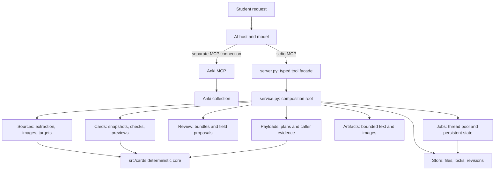

# AnkiPlus MCP developer guide

[README](../README.md) · [Tool reference](tools.md) · [Setup/configuration](setup.md)

This guide describes the current `ankiplusmcp` server and launcher. The original
`cards` CLI still ships in the same Python package; its mandatory phase/gate
workflow is documented separately in [legacy architecture](legacy/architecture.md).

## Architecture

AnkiPlus separates deterministic helpers from model judgement. The host model
chooses tools, drafts notes and interprets reviews. The server performs local
extraction, OCR, persistence, checks, rendering and payload construction. It has
no model-provider client and no Anki client. Collection operations belong to a
separately configured Anki MCP, with the host moving data between the servers.



The arrows describe call/dependency relationships, not a compulsory workflow.
An extraction-only request does not need cards or Anki. Rendering existing notes
does not need a lecture. A host may use Anki MCP without using AnkiPlus at all.

### Process startup and launcher

The optional Node launcher has no runtime npm dependencies. It locates uv,
constructs the pinned Python package spec, and passes server arguments through
as separate argv entries. Its default package source is the Git tag matching
`package.json`'s version. It does not proxy individual MCP requests.

| File | Responsibility |
| --- | --- |
| [launcher/cli.mjs](../launcher/cli.mjs) | Route serve/init/doctor/setup/uninstall and keep serving stdout reserved for MCP. |
| [launcher/lib/uv.mjs](../launcher/lib/uv.mjs) | Find uv from an override, PATH or the standard install location. |
| [launcher/lib/spec.mjs](../launcher/lib/spec.mjs), [serve.mjs](../launcher/lib/serve.mjs) | Pin the Python source and launch uv with inherited stdio. |
| [launcher/lib/hosts.mjs](../launcher/lib/hosts.mjs), [configfile.mjs](../launcher/lib/configfile.mjs) | Describe host-specific registrations and safe configuration edits. |
| [launcher/lib/init.mjs](../launcher/lib/init.mjs) | Confirm changes, back up/register, install optional skills, track ownership and uninstall. |
| [ankiplusmcp/__main__.py](../src/ankiplusmcp/__main__.py) | Route Python serve/doctor/setup, resolve settings and close the service on exit. |
| [settings.py](../src/ankiplusmcp/settings.py), [doctor.py](../src/ankiplusmcp/doctor.py) | Profiles, roots, browser selection and dependency diagnostics. |

The Python entry point can be run directly: Node is a convenience for installing
and registering it. [Setup](setup.md) preserves the exact host support, flags,
configuration precedence and unattended exit codes.

### MCP facade and service composition

[server.py](../src/ankiplusmcp/server.py) exposes the public methods of `API`
through FastMCP. Pydantic models/annotations define tool input schemas. The wrapper:

1. Resolves source roots on first use if flags/environment did not provide them.
2. Runs the synchronous method in an AnyIO worker thread, keeping the async MCP
   server responsive while file/native work runs.
3. Converts JSON output into text plus structured MCP content, bounded to
   64,000 characters. Images use `CallToolResult` image content directly.
4. Converts known domain, validation and I/O exceptions into an MCP error with
   `code`, `message` and `remedy`.

[Service](../src/ankiplusmcp/service.py) composes the `Sources`, `Artifacts`,
`Cards`, `Review` and `Payloads` mixins around one `Store`, `Jobs` manager, profile
and browser choice. These are groups of methods sharing local state, not remote
services. Follow the implementation links in the [tool reference](tools.md) for
the call path of each of the 33 tools.

MCP annotations are host hints, not filesystem guarantees. For example,
`prepare_review` only builds a bundle, while `prepare_write` writes artifacts
without changing the workspace revision. A tool can change local artifacts
without making any Anki collection mutation.

### Reuse of the legacy toolkit

The MCP layer imports deterministic functions from `src/cards/` for extraction,
OCR, deck identity, figure markup, checks, inert rendering and text imports. It
owns its own workspace/API and does not manufacture a legacy `build.json`, run
CLI phase transitions or require legacy gates. `measure_usage` is a remaining
CLI-style adapter: it constructs an argument object for `cards.meter.run`.

| Current area | Core implementation reused |
| --- | --- |
| Source text, maps, objectives, figure labels | [cards/extract](../src/cards/extract), [cards/source.py](../src/cards/source.py), [common/source_data.py](../src/cards/common/source_data.py) |
| OCR rectangles and native image masks | [extract/ocr.py](../src/cards/extract/ocr.py), [figures.py](../src/cards/figures.py) |
| Deck/tag suggestions | [target.py](../src/cards/target.py) |
| Optional style and coverage | [check/lint.py](../src/cards/check/lint.py), [check/coverage.py](../src/cards/check/coverage.py) |
| Rendering and media sanitisation | [cards/render](../src/cards/render) |
| Text import output | [write/importfile.py](../src/cards/write/importfile.py) |
| Usage diagnostics | [cards/meter](../src/cards/meter) |

The [capability mapping](capabilities.md) connects historical commands to current
tools. Existing CLI behaviour and frozen contracts remain compatibility constraints.

## Workspace storage and revisions

Each task is a directory named by a UUID under the configured workspace root.
There is no database and no global “current workspace”. Source originals are
read-only inputs: a requested source is copied into the workspace and hashed.

```text
<workspace-root>/
  .cache/ocr/                     # Shared content-addressed OCR cache
  <workspace-id>/
    workspace.json               # ID, mode, revision, provenance, source pointer
    input/source.pdf             # Or .txt/.md/.markdown; read-only snapshot
    cards.json                   # Complete saved card set
    omissions.json               # Deliberate lecture omissions
    jobs/<job-id>.json            # Status/progress/result/error
    extractions/<id>/engine/     # Staged/published source artifacts
    source-partial.json          # Temporary early-text marker while OCR runs
    exports/<id>/                # Explicit figure exports and manifest
    media/                       # Imported images, IO media and mask previews
    ocr/<id>.json                 # OCR region results
    occlusions/<id>.json          # Generated mask fields and media references
    previews/<id>/               # Render input, sheets and optional samples
    latest-preview.json          # Current preview snapshot metadata
    reviews/<id>.json            # Findings, field proposals and card hash
    write/<plan-id>/              # Plan, batches, import files, external results
    latest-plan.json             # Pointer to the latest plan
    usage/<id>/                  # Optional transcript diagnostics
```

Only artifacts actually produced exist; this is not a required directory scaffold.
Hidden workspace/job lock files and root-level owner lease locks also exist.
Do not infer current state from a staged file's existence: use manifest pointers,
job status and hashes.

[Store](../src/ankiplusmcp/store.py) checks workspace IDs, rejects path traversal
and artifact symlinks, and bounds source reads to explicitly resolved readable
roots. Imports validate source images and byte/pixel limits. JSON is written
with the core's atomic-file helper. FileLock locks coordinate threads/processes;
JSON writes do not make a multi-file operation a database transaction.

`Store.edit(workspace, expected_revision)` locks the workspace, compares the
revision when supplied, performs the edit, then increments/persists the manifest.
`STALE` means the caller must re-read and reconcile its proposed change.
Some artifact producers also increment revisions: page rasterisation, image
import, OCR, occlusion generation and rendering. Other operations, such as
preparing a write plan, write files without incrementing it. Always re-read after
background operations rather than predicting the next revision.

Card hashes provide another consistency check. Reviews bind to a card snapshot,
previews bind to both the snapshot and selected IDs, and plans bind to the saved
card hash. `save_cards` replaces the entire set; it is not an append or patch API.
There is no automatic garbage collector or workspace-deletion tool.

## Background jobs and extraction publication

[Jobs](../src/ankiplusmcp/jobs.py) uses a two-worker `ThreadPoolExecutor` and
persistent JSON job records. Extraction, figure export, OCR and rendering return
a job record immediately. Status transitions are:

```text
queued -> running -> completed | failed | cancelled
queued -> cancelled
queued/running with a dead owner -> interrupted (detected on get_job)
```

An owner lease lock distinguishes a server restart from another live process.
Restarted operations are not automatically resumed/retried. Callers inspect the
result/error and decide whether to repeat an operation.

Cancellation is cooperative. It is checked at safe operation boundaries, not
by killing native Tesseract or Chromium calls. `cancel_requested` is not terminal
status. Late cancellation cannot roll back an already committed extraction or
preview. Failed/cancelled jobs can leave staged/cache files.

Source extraction checks the source snapshot hash, reuses a compatible published
extraction when possible, and otherwise extracts into a fresh UUID folder without
holding the workspace lock for all OCR. Once text/crops are ready it publishes an
early-text marker; read/search/figure tools can answer while OCR continues.
`labels_pending: true` and `ocr_labels: null` distinguish unread labels from an
empty completed OCR result. Coverage waits for the finished extraction. Final
publication checks the hash again and updates the manifest's source pointer.
An existing published extraction wins over replacement early text.

Rendering captures a card selection/revision, builds inert HTML rows under an
edit guard, and only marks `latest-preview.json` current after completed output
and cancellation checks. Visual review validates both card hash and exact selection.

## Validation, reviews and Anki handoff

[models.py](../src/ankiplusmcp/models.py) defines strict `Card`, `Media`, `Region`,
`Finding` and `ExternalResult` inputs; unknown fields are forbidden. Arbitrary
Anki note fields are supported. `kind` chooses cloze/basic/image-occlusion
behaviour; it does not automatically choose the corresponding Anki note type.
Specify `notetype` for Basic/IO/custom models; missing values use the profile.

Technical validation checks cloze syntax and IO markup. House style and lecture
coverage are optional. Factual accuracy remains the user's/model's judgement.
Optional review bundles do not spawn agents. Reviewer labels are unverified
caller-supplied identities. Proposals do not change fields until `apply=true`.
Applying field changes clears supplied question/answer HTML to avoid retaining
outdated pre-rendered content.

Payload preparation always runs technical checks, then creates local batches,
updates, media references, text imports and suspension intentions. It performs
zero Anki operations. Creates are grouped by deck, model and field ordering,
with at most 100 notes per batch. Conflicting updates to the same note field or
conflicting image content under one destination filename are refused.

The host must read payload artifacts, execute the desired operations through
Anki MCP, resolve actual card IDs when needed, and read back actual note fields
for verification. Local draft IDs, Anki note IDs and Anki card IDs are distinct.
Tier-3 suspension entries are intentions until the host acts on real card IDs.

`record_external_results` stores evidence with `caller_supplied` origin and
`independently_verified: false`. `get_report` counts submitted result records;
planned create/update numbers are not successful-write counts. Ambiguous writes
must be reconciled against Anki before retrying to avoid duplicates.

### Sequencing a study request across servers

The [worked study workflow](study-workflow.md) illustrates the host's orchestration
responsibilities. The server has no collection-search, automatic gap-detection,
human-approval or write-execution tool. Reuse selection and explanatory card
content are model decisions based on source material and external snapshots.

Keep preview-only existing-note snapshots out of new-note write plans; the input
model defaults `action` to `create`. Coverage examines one workspace's selected
local cards and omissions, not the host's external reuse list or another
workspace. `submit_review` is evidence storage, not a human approval receipt.

Wait for jobs to finish before reading the revision used for a following edit.
For example, `render_cards` can increment the workspace revision without changing
card fields, so a review submitted with a pre-render revision can be refused.
Refreshing and reconciling is the supported recovery. Anki deck creation limits
and network-stream failures belong to the companion/host; they are not reasons
to add collection proxy code or bypass revision checks in AnkiPlus.

## Development setup

Use Python 3.12+ and Node 18+. Tests here have been exercised on Python 3.14/Linux;
CI also defines macOS and Node 18/22 jobs. Install system Tesseract for OCR tests.

```sh
python3 -m venv .venv
.venv/bin/pip install -e '.[dev]'
.venv/bin/python -m playwright install chromium
```

On a Linux development machine missing browser libraries, use Playwright's
`install --with-deps chromium` instead (its system-package step may require
administrator permissions). The Dockerfile handles those dependencies itself.

Run the Python server directly for an MCP client to connect over stdio:

```sh
.venv/bin/python -m ankiplusmcp --source-root /absolute/lectures
```

It waits for protocol messages; it is not an interactive shell or web server.
For local launcher testing without fetching the tagged remote Python version:

```sh
export ANKIPLUSMCP_PY_SPEC="ankiplusmcp[all] @ file://$PWD"
node launcher/cli.mjs doctor
```

The npm launcher and Python package versions must match, because released
launchers install Python from the matching Git tag. Setuptools builds the wheel;
its floor supports SPDX licence metadata. Runtime/container dependencies are
pinned in `requirements.lock`; `uv.lock` supports uv-managed development.

### Checks and verification

```sh
./scripts/check.sh
```

This composes the existing checks without changing them:

1. `scripts/check_privacy.py`: scans tracked text for personal paths/emails.
2. `scripts/check_versions.py`: checks launcher/Python version agreement.
3. `npm test`: dependency-free launcher tests.
4. `scripts/check-mcp.sh`: MCP tests, legacy unit tests, synthetic foundational
   contracts, frozen contract checksums and a wheel build.

For a narrower loop, run `npm test`, `./scripts/check-mcp.sh`, or a selected
`.venv/bin/python -m pytest -q tests/mcp/<test_file>.py`.
The default Python check does not run the entire private-data contract suite.
Missing private fixtures must be reported; do not edit frozen tests to hide them.
An explicit test skip is also not a passed case.

Packaging/protocol checks:

```sh
npm pack --dry-run
.venv/bin/python scripts/smoke-mcp.py
```

The smoke helper uses an SDK stdio client and synthetic input. Its default
command targets `.venv/bin/python -m ankiplusmcp` from this checkout. To test an
installed wheel from outside the checkout, supply the absolute installed
`ankiplusmcp` executable using `--command` from a disposable directory. CI has
additional wheel-install and npx/uv integration jobs in
[ci.yml](../.github/workflows/ci.yml).

| Tests | Main responsibility |
| --- | --- |
| [tests/mcp/test_protocol.py](../tests/mcp/test_protocol.py) | Actual SDK stdio discovery, images, structured results and errors. |
| [tests/mcp/test_store.py](../tests/mcp/test_store.py), [test_locking.py](../tests/mcp/test_locking.py) | Containment, revisions, atomic snapshots, concurrent processes and job ownership. |
| [tests/mcp/test_sources.py](../tests/mcp/test_sources.py), [test_adapters.py](../tests/mcp/test_adapters.py) | Extraction, early text, caching, figures, OCR and adapter behaviour. |
| [tests/mcp/test_cards.py](../tests/mcp/test_cards.py), [test_review_regressions.py](../tests/mcp/test_review_regressions.py) | Card checks, rendering, scoped review, staleness, payload conflicts and evidence. |
| [tests/mcp/test_settings.py](../tests/mcp/test_settings.py), [test_profiles.py](../tests/mcp/test_profiles.py), [test_doctor.py](../tests/mcp/test_doctor.py) | Roots, profiles, browser selection and dependency errors. |
| [tests/mcp/test_packaging_meta.py](../tests/mcp/test_packaging_meta.py) | Runtime version and package/extras contract. |
| [launcher/test](../launcher/test) | Host edits/backups/ownership, launcher arguments, stdio, uv and command exits. |
| [tests/unit](../tests/unit), [tests/contract](../tests/contract) | Legacy compatibility; frozen contracts are not editable. |

See the [verification record](development/verification.md) for dated results and limitations.
Do not interpret historical evidence as a claim that live Anki, every host UI,
Windows or all private-fixture cases have been tested.

## Optional stdio container

This container is an MCP transport, not a website. It exposes no port and needs
no Traefik route. Use rootless Docker without sudo on this host.

```sh
ANKIPLUS_REVISION="$(git rev-parse --short HEAD)"
if test -n "$(git status --porcelain)"; then ANKIPLUS_REVISION="$ANKIPLUS_REVISION-dirty"; fi
export ANKIPLUS_REVISION
export ANKIPLUS_SOURCES=/absolute/lectures
docker compose -p ankiplusmcp config --quiet
docker compose -p ankiplusmcp build
./scripts/run-container.sh "$ANKIPLUS_REVISION" "$ANKIPLUS_SOURCES"
```

The image records its source revision in its OCI label; uncommitted source must
be marked dirty. The wrapper requires an existing image and never emits build
logs into protocol stdout. Configure the AI host to execute the wrapper with
those revision/source arguments when using this transport.

The container runs non-root with no network, a read-only filesystem, dropped
capabilities, no-new-privileges, bounded CPU/RAM/PIDs, rotating logs and temporary
scratch space. Sources mount read-only at `/sources`; persistent workspaces use
the project-specific named volume. Use `/sources/...` paths in MCP calls rather
than host paths. Import media from that mount. Do not remove the volume to clean
up a container: it holds saved workspaces.

The [Dockerfile](../Dockerfile) installs locked runtime dependencies, Chromium
and Tesseract. It installs `libatomic1` before invoking Playwright because the
bundled Node driver needs that library even to install browser dependencies.
The repository is the build context;
[.dockerignore](../.dockerignore) excludes Git, secrets, caches, dependencies,
private fixtures, build outputs and worktrees. See [compose.yaml](../compose.yaml)
and [.env.example](../.env.example) for the actual runtime configuration.

## Extending a tool

1. Read [AGENTS.md](../AGENTS.md) and the approved design constraints. Keep Anki
   collection/network code out of this server and preserve the legacy CLI.
2. Put typed public inputs in `models.py` or facade annotations. Keep `API`
   methods thin and implement behaviour in the appropriate mixin/core adapter.
3. Use `Store` for path validation, atomic writes and revision-checked edits.
   Do not bypass the source-root/workspace distinction.
4. Put expensive extraction/OCR/rendering work in `Jobs`, with safe cancellation
   and publication boundaries. Bound text/image output before returning it.
5. Exercise behaviour through MCP/service tests with synthetic inputs, including
   staleness, malformed input, missing dependencies and partial work as relevant.
6. Update [tools.md](tools.md), the README tool index and architecture guidance
   when public behaviour changes. Keep Python/launcher versions aligned for a release.

Keep stdout exclusive to MCP when serving. Never fabricate Anki verification,
reviewer independence or successful-write counts from a local plan.
